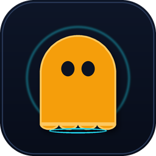

<!-- =====================================================================
     GhostPilot NEX — README
     10 dil · kullanıcı odaklı · tek kaynak dosya (GitHub Pages gerekmez)
     Diller: EN · TR · DE · ES · PT · FR · RU · AR · ZH · JA
     ===================================================================== -->

<div align="center">



# 👻 GhostPilot

**Your real computer, not a sandbox.**
**Gerçek bilgisayarınız — sandbox değil.**


[](LICENSE)
[](https://python.org)
[](#-all-tools)
[](#-tests)
[](#-free-plan)

<p>
<a href="https://buymeacoffee.com/btmcode"></a>
<a href="https://github.com/Btmcode/Ghost-Pilot/stargazers"></a>
</p>

**🌍 Languages** —
[English](#-english) ·
[Türkçe](#-türkçe) ·
[Deutsch](#-deutsch) ·
[Español](#-español) ·
[Português](#-português) ·
[Français](#-français) ·
[Русский](#-русский) ·
[العربية](#-العربية) ·
[中文](#-中文) ·
[日本語](#-日本語)

</div>

---

<div align="center">

### ☕ GhostPilot is free forever

20.000 calls a month, no account, no telemetry, **no selling**.
If it saves you time, you can keep it alive with a coffee.

<a href="https://buymeacoffee.com/btmcode"></a>

</div>

---

<div dir="ltr" align="left">

# 🇬🇧 English

## What is GhostPilot?

GhostPilot is a small program that runs on **your own computer**. It lets an AI assistant — ChatGPT, Claude, Cursor or any MCP‑compatible tool — actually *use* your machine: read your files, run commands, look at your screen and click buttons.

Everything happens locally. Your files are never uploaded. There is no cloud account, no telemetry, no vendor sandbox.

## Why not a cloud agent?

| | Cloud agent | **GhostPilot** |
|---|---|---|
| Where it runs | Someone else's server | **Your computer** |
| Your files | Copies must be uploaded | **The real ones, in place** |
| Your programs | Cannot see them | **Everything installed** |
| Your data | Leaves your device | **Never leaves** |
| Works offline | No | **Yes** |
| Can click your apps | No | **Yes** |

## Install in one minute

**Windows** — download the zip, extract it, double‑click **`KURULUM.bat`**. A wizard installs GhostPilot, creates a desktop shortcut and starts it.

**macOS / Linux**

```bash
git clone https://github.com/Btmcode/Ghost-Pilot.git
cd Ghost-Pilot
python3 kurulum.py
```

Then try it without leaving the terminal:

```bash
python ghostpilot.py doctor      # checks your setup
python ghostpilot.py tools       # lists all 81 tools
python ghostpilot.py relay       # opens the remote bridge
```

## Connect your assistant

### ChatGPT

1. Start **GhostPilot** from the desktop shortcut.
2. Press **"Connect to ChatGPT"** and wait 10–40 seconds.
3. Copy the address it shows (it looks like `https://xxxx.free.pinggy.net/mcp?token=…`).
   *This address contains your access key — keep it private.*
3. Open <https://chatgpt.com/plugins> → **Add** → **Custom MCP server**.
4. Paste the address as the server URL, choose **OAuth** for authentication, tick the box and press **Add**.

A step‑by‑step guide with every form field is in **[BAGLA.md](BAGLA.md)**.

### Claude Desktop / Cursor / VS Code

Add a stdio server entry pointing to the bridge:

```json
{
  "mcpServers": {
    "ghostpilot": {
      "command": "python",
      "args": ["C:/path/to/Ghost-Pilot/ghostpilot.py", "bridge"]
    }
  }
}
```

## What can it do?

- **Terminal that stays open.** Start a Python REPL, a PowerShell session or an SSH login, type into it, read the output — and if the server restarts, the session survives and you can keep typing into it.
- **Files, safely.** Atomic multi‑block edits: if one block does not match, *nothing* is written — never a half‑saved file. Symlink and junction escapes are blocked.
- **Search without waiting.** Big folder scans run in the background; results come back page by page, and truncation is always stated out loud.
- **Real UI control.** Find a button by its name, click it, and get proof that something actually changed on screen. A visible ghost cursor shows every move; your physical mouse never jumps.
- **Multi‑device.** Drive a Windows host *and* an Ubuntu workstation as two independent agents over a signed, encrypted‑ready connection. No Tailscale, no VPN account.
- **Full audit.** Every call is logged with device, session, duration and result — with secrets masked before they touch the disk.

## Free plan

| | Free | Unlimited |
|---|---|---|
| Calls per month | **20.000** | none |
| Account needed | No | No |
| Support key | optional | — |
| Selling your data | Never | Never |

Counting is fair: only **real work** counts. Timeouts, rejected calls and connection drops are not charged. Running `python ghostpilot.py sinirsiz` removes the monthly cap; every security gate still applies.

## Security model

GhostPilot runs with **your** permissions, so safety is built in, not bolted on:

- **Three permission tiers.** Read (free) · Write (workspace only) · Dangerous (explicit approval required).
- **Approval cannot be bypassed.** The token is single‑use, bound to that exact command, and expires in 120 seconds. Writing `"approve": true` inside a tool call does nothing.
- **Absolute bans.** `rm -rf /`, `mkfs`, `dd if=`, shutdown and credential theft are refused **even with approval**.
- **Sandbox on real paths.** Symlinks, junctions and hardlinks are resolved before the check, so a link that points outside your workspace is rejected.
- **No secrets in logs.** Tokens, passwords, bearer headers and private keys are masked at two layers; the test suite proves it on real calls.

A full policy test with 28 bypass attempts ships in the repo: `python3 testler.py`.

## Tests

```
python3 testler.py            59 / 59 passing     (Linux / Xvfb)
python3 testler.py --modul                       (modules only)
python3 testler_windows.py                      (Windows only — refuses to run elsewhere)
```

Linux and Windows results are reported **separately**. Windows‑specific features (PowerShell sessions, `taskkill /T`, real UI automation, Hyper‑V) are verified on Windows and are never marked as passing from a Linux run.

## All tools

<details>
<summary><b>81 tools — click to expand</b></summary>

**Terminal** `start_process` `read_process_output` `interact_with_process` `list_sessions` `terminate_session` `kill_process`
**Search** `start_search` `get_more_search_results` `stop_search` `list_searches`
**Files** `read_multiple_files` `edit_block` `link_check` `read_file` `write_file` `list_directory` `glob` `grep`
**UI** `get_window_info` `find_ui_element` `interact_with_ui_element` `vm_coordinates` `gozle` `screenshot` `cursor_click` `type_text`
**Audit** `get_recent_tool_calls` `get_usage_stats` `get_audit_log` `nex_hud` `mask_test`
**Devices** `list_devices` `add_device` `remove_device` `device_health` `device_call`
**Security** `check_action` `approve_action` `list_approvals` `policy_test`
**Classic** `status` `machine` `schedule_*` `belge` `kota_durumu` …

Old Turkish tool names are kept as aliases, so existing prompts keep working.

</details>

## Support the project

GhostPilot is free and always will be. There is no paid tier, nothing is sold, and your data is never monetised.

If it earns you time, a coffee is the whole business model:

<p align="center">
<a href="https://buymeacoffee.com/btmcode"></a>
</p>

Or simply **star the repo** and tell one person about it — that helps just as much.

## Docs

| Document | What it covers |
|---|---|
| [BAGLA.md](BAGLA.md) | Connect to ChatGPT, field by field |
| [KURULUM_REHBERI.md](KURULUM_REHBERI.md) | Detailed installation |
| [FULL_SURUM.md](FULL_SURUM.md) | What the full version adds |
| [TEST_RAPORU.md](TEST_RAPORU.md) | Test report, phase by phase |
| [SECURITY.md](SECURITY.md) | Security policy |
| [GIZLILIK.md](GIZLILIK.md) | Privacy |
| [KOSULLAR.md](KOSULLAR.md) | Terms |

## Credits

Built by **BTM Code** · MIT Licence · Not affiliated with OpenAI, Anthropic or any other vendor.

---

# 🇹🇷 Türkçe

## GhostPilot nedir?

GhostPilot **kendi bilgisayarınızda** çalışan küçük bir programdır. Yapay zekâ asistanınızın — ChatGPT, Claude, Cursor veya MCP destekleyen herhangi bir araç — makinenizi gerçekten *kullanmasını* sağlar: dosyalarınızı okur, komut çalıştırır, ekranınıza bakar, düğmelere basar.

Her şey bilgisayarınızda olur. Dosyalarınız hiçbir yere yüklenmez. Bulut hesabı yok, telemetri yok, satıcı sandbox'ı yok.

## Bulut ajanından farkı ne?

| | Bulut ajanı | **GhostPilot** |
|---|---|---|
| Nerede çalışır | Başkasının sunucusu | **Sizin bilgisayarınız** |
| Dosyalarınız | Önce yüklenmeli | **Yerinde, gerçeği** |
| Programlarınız | Göremez | **Kurulu her şey** |
| Veriniz | Cihazdan çıkar | **Hiç çıkmaz** |
| İnternetsiz çalışır | Hayır | **Evet** |
| Uygulamalarınıza tıklar | Hayır | **Evet** |

## Bir dakikada kurulum

**Windows** — zip'i indirin, klasöre çıkarın, **`KURULUM.bat`** dosyasına çift tıklayın. Sihirbaz programı kurar, masaüstü kısayolu oluşturur ve başlatır.

**macOS / Linux**

```bash
git clone https://github.com/Btmcode/Ghost-Pilot.git
cd Ghost-Pilot
python3 kurulum.py
```

Terminalden çıkmadan deneyin:

```bash
python ghostpilot.py doctor      # kurulumu denetler
python ghostpilot.py tools       # 81 aracın tamamını listeler
python ghostpilot.py relay       # uzak köprüyü açar
```

## Asistanınızı bağlayın

### ChatGPT

1. Masaüstündeki **GhostPilot** kısayolundan programı açın.
2. **"ChatGPT'ye bağlan"** düğmesine basın ve 10–40 saniye bekleyin.
3. Ekranda çıkan adresi kopyalayın (`https://xxxx.free.pinggy.net/mcp?token=…`).
   *Bu adres erişim anahtarınızı içerir — kimseyle paylaşmayın.*
3. <https://chatgpt.com/plugins> → **Ekle** → **Özel MCP sunucusu**.
4. Adresi sunucu URL'si olarak yapıştırın, kimlik doğrulama için **OAuth** seçin, kutuyu işaretleyip **Ekle**'ye basın.

Her form alanının ne olacağı **[BAGLA.md](BAGLA.md)** dosyasında tek tek yazılı.

### Claude Desktop / Cursor / VS Code

Köprüye işaret eden bir stdio sunucusu ekleyin:

```json
{
  "mcpServers": {
    "ghostpilot": {
      "command": "python",
      "args": ["C:/yol/Ghost-Pilot/ghostpilot.py", "bridge"]
    }
  }
}
```

## Neler yapabilir?

- **Kapanmayan terminal.** Python REPL, PowerShell veya SSH oturumu açın; içine yazın, çıktıyı okuyun. Sunucu yeniden başlasa bile oturum yaşar ve **yazmaya devam edersiniz**.
- **Güvenli dosya düzenleme.** Çoklu blok düzenleme atomiktir: bloklardan biri tutmazsa **hiçbir şey** yazılmaz — yarım dosya kalmaz. Symlink/junction kaçışları engellenir.
- **Beklemeden arama.** Büyük klasör taramaları arka planda çalışır, sonuçlar sayfa sayfa gelir, kırpma her zaman açıkça söylenir.
- **Gerçek arayüz kontrolü.** Düğmeyi adından bulur, tıklar ve ekranda gerçekten bir şey değiştiğini **kanıtlar**. Görünür hayalet imleç her hareketi gösterir; fiziksel fareniz asla yerinden oynamaz.
- **Çoklu cihaz.** Windows host ve Ubuntu AI‑Workstation'ı iki bağımsız ajan olarak yönetin. Tailscale yok, VPN hesabı yok; bağlantı imzalıdır.
- **Tam denetim.** Her çağrı cihaz, oturum, süre ve sonuçla kaydedilir — gizli bilgiler diske yazılmadan önce maskelenir.

## Ücretsiz plan

| | Ücretsiz | Sınırsız |
|---|---|---|
| Aylık çağrı | **20.000** | sınır yok |
| Hesap gerekir | Hayır | Hayır |
| Destek anahtarı | isteğe bağlı | — |
| Veri satışı | Asla | Asla |

Sayım adildir: yalnızca **gerçek çalışmalar** sayılır. Zaman aşımı, reddedilen çağrı ve bağlantı kopması ücretlendirilmez. `python ghostpilot.py sinirsiz` aylık sınırı kaldırır; güvenlik kapılarının tamamı yine geçerlidir.

## Güvenlik modeli

GhostPilot **sizin** yetkilerinizle çalışır; bu yüzden güvenlik sonradan eklenen bir katman değil, tasarımın parçasıdır:

- **Üç kademe.** Okuma (serbest) · Yazma (yalnız çalışma alanı) · Tehlikeli (açık onay şart).
- **Onay atlatılamaz.** Belirteç tek kullanımlıktır, o komuta bağlıdır ve 120 saniyede düşer. Araç çağrısının içine `"approve": true` yazmak hiçbir işe yaramaz.
- **Mutlak yasaklar.** `rm -rf /`, `mkfs`, `dd if=`, sistem kapatma ve kimlik bilgisi hırsızlığı **onay verilse bile** çalışmaz.
- **Gerçek yol denetimi.** Symlink, junction ve hardlink çözüldükten sonra denetlenir; çalışma alanı dışına çıkan link reddedilir.
- **Loglarda gizli bilgi yok.** Token, şifre, bearer başlığı ve özel anahtarlar iki katmanda maskelenir; test bunu gerçek çağrılar üzerinde kanıtlar.

28 atlatma denemesi içeren politika testi depoda: `python3 testler.py`.

## Testler

```
python3 testler.py            59 / 59 geçti      (Linux / Xvfb)
python3 testler_windows.py                      (yalnız Windows — başka yerde çalışmayı reddeder)
```

Linux ve Windows sonuçları **ayrı** raporlanır. Windows'a özgü yetenekler (PowerShell oturumları, `taskkill /T`, gerçek arayüz otomasyonu, Hyper‑V) Windows'ta doğrulanır; bir Linux koşusundan asla "geçti" olarak işaretlenmez.

## Tüm araçlar

<details>
<summary><b>81 araç — açmak için tıklayın</b></summary>

**Terminal** `start_process` `read_process_output` `interact_with_process` `list_sessions` `terminate_session` `kill_process`
**Arama** `start_search` `get_more_search_results` `stop_search` `list_searches`
**Dosya** `read_multiple_files` `edit_block` `link_check` `read_file` `write_file` `list_directory` `glob` `grep`
**Arayüz** `get_window_info` `find_ui_element` `interact_with_ui_element` `vm_coordinates` `gozle` `screenshot` `cursor_click` `type_text`
**Denetim** `get_recent_tool_calls` `get_usage_stats` `get_audit_log` `nex_hud` `mask_test`
**Cihaz** `list_devices` `add_device` `remove_device` `device_health` `device_call`
**Güvenlik** `check_action` `approve_action` `list_approvals` `policy_test`
**Klasik** `status` `machine` `schedule_*` `belge` `kota_durumu` …

Eski Türkçe araç adları alias olarak korunur; mevcut komutlarınız çalışmaya devam eder.

</details>

## Projeyi destekle

GhostPilot ücretsizdir ve ücretsiz kalacak. Ücretli sürüm yok, hiçbir şey satılmıyor, veriniz paraya çevrilmiyor.

Size zaman kazandırıyorsa, iş modelinin tamamı bir kahve:

<p align="center">
<a href="https://buymeacoffee.com/btmcode"></a>
</p>

Ya da sadece **yıldız verin** ve bir kişiye anlatın — o da aynı işi görür.

## Belgeler

| Belge | İçerik |
|---|---|
| [BAGLA.md](BAGLA.md) | ChatGPT'ye bağlanma, alan alan |
| [KURULUM_REHBERI.md](KURULUM_REHBERI.md) | Ayrıntılı kurulum |
| [FULL_SURUM.md](FULL_SURUM.md) | Tam sürümün ekledikleri |
| [TEST_RAPORU.md](TEST_RAPORU.md) | Faz faz test raporu |
| [SECURITY.md](SECURITY.md) | Güvenlik politikası |
| [GIZLILIK.md](GIZLILIK.md) | Gizlilik |
| [KOSULLAR.md](KOSULLAR.md) | Koşullar |

---

# 🇩🇪 Deutsch

## Was ist GhostPilot?

GhostPilot ist ein kleines Programm, das auf **Ihrem eigenen Rechner** läuft. Es erlaubt einem KI‑Assistenten — ChatGPT, Claude, Cursor oder jedem MCP‑fähigen Werkzeug — Ihren Rechner wirklich zu *benutzen*: Dateien lesen, Befehle ausführen, auf den Bildschirm sehen und Schaltflächen anklicken.

Alles passiert lokal. Ihre Dateien werden nie hochgeladen. Kein Cloud‑Konto, keine Telemetrie, keine Sandbox eines Anbieters.

## Warum kein Cloud‑Agent?

| | Cloud‑Agent | **GhostPilot** |
|---|---|---|
| Läuft wo | Auf fremden Servern | **Auf Ihrem Rechner** |
| Ihre Dateien | Müssen hochgeladen werden | **Die echten, an Ort und Stelle** |
| Ihre Programme | Sieht sie nicht | **Alles Installierte** |
| Ihre Daten | Verlassen das Gerät | **Bleiben hier** |
| Offline nutzbar | Nein | **Ja** |
| Klickt Ihre Apps | Nein | **Ja** |

## Installation in einer Minute

**Windows** — Zip herunterladen, entpacken, **`KURULUM.bat`** doppelklicken. Ein Assistent installiert, legt eine Desktop‑Verknüpfung an und startet das Programm.

**macOS / Linux**

```bash
git clone https://github.com/Btmcode/Ghost-Pilot.git
cd Ghost-Pilot
python3 kurulum.py
```

Sofort ausprobieren:

```bash
python ghostpilot.py doctor      # prüft die Installation
python ghostpilot.py tools       # listet alle 81 Werkzeuge
python ghostpilot.py relay       # öffnet die Fernbrücke
```

## Assistent verbinden

### ChatGPT

1. GhostPilot über die Desktop‑Verknüpfung starten.
2. **„Mit ChatGPT verbinden"** drücken, 10–40 Sekunden warten.
3. Die angezeigte Adresse kopieren (`https://xxxx.free.pinggy.net/mcp?token=…`).
   *Diese Adresse enthält Ihren Zugangsschlüssel — nicht weitergeben.*
3. <https://chatgpt.com/plugins> öffnen → **Hinzufügen** → **Eigener MCP‑Server**.
4. Adresse als Server‑URL einfügen, als Authentifizierung **OAuth** wählen, Häkchen setzen, **Hinzufügen**.

Jedes Formularfeld ist in **[BAGLA.md](BAGLA.md)** einzeln erklärt.

### Claude Desktop / Cursor / VS Code

Einen stdio‑Server auf die Brücke zeigen lassen:

```json
{
  "mcpServers": {
    "ghostpilot": {
      "command": "python",
      "args": ["C:/Pfad/Ghost-Pilot/ghostpilot.py", "bridge"]
    }
  }
}
```

## Was kann es?

- **Terminal, das offen bleibt.** Python‑REPL, PowerShell oder SSH starten, hineinschreiben, Ausgaben lesen — und nach einem Serverneustart **weiter tippen**.
- **Sicheres Bearbeiten.** Mehrblock‑Änderungen sind atomar: Passt ein Block nicht, wird **nichts** geschrieben — keine halben Dateien. Symlink‑Fluchten werden blockiert.
- **Suchen ohne Warten.** Große Ordner laufen im Hintergrund; Ergebnisse kommen seitenweise, Kürzungen werden immer ausdrücklich gemeldet.
- **Echte Oberflächensteuerung.** Schaltfläche am Namen finden, klicken und **beweisen**, dass sich am Bildschirm etwas geändert hat. Ein sichtbarer Geister‑Cursor zeigt jede Bewegung; Ihre echte Maus springt nie.
- **Mehrere Geräte.** Windows‑Host *und* Ubuntu‑Workstation als zwei unabhängige Agenten — signiert, ohne Tailscale, ohne VPN‑Konto.
- **Vollständiges Audit.** Jeder Aufruf wird mit Gerät, Sitzung, Dauer und Ergebnis protokolliert; Geheimnisse werden vor dem Schreiben maskiert.

## Kostenloser Plan

| | Kostenlos | Unbegrenzt |
|---|---|---|
| Aufrufe pro Monat | **20.000** | kein Limit |
| Konto nötig | Nein | Nein |
| Support‑Schlüssel | optional | — |
| Datenverkauf | Nie | Nie |

Gezählt wird fair: nur **echte Arbeit**. Timeouts, abgelehnte Aufrufe und Verbindungsabbrüche kosten nichts. `python ghostpilot.py sinirsiz` hebt das Monatslimit auf; alle Sicherheitsprüfungen bleiben aktiv.

## Sicherheitsmodell

- **Drei Stufen.** Lesen (frei) · Schreiben (nur Arbeitsbereich) · Gefährlich (ausdrückliche Freigabe).
- **Freigabe nicht umgehbar.** Einmal‑Token, an genau diesen Befehl gebunden, 120 Sekunden gültig. `"approve": true` im Aufruf bewirkt nichts.
- **Absolute Verbote.** `rm -rf /`, `mkfs`, `dd if=`, Herunterfahren und Diebstahl von Zugangsdaten werden **auch mit Freigabe** verweigert.
- **Prüfung auf echten Pfaden.** Symlinks, Junctions und Hardlinks werden aufgelöst, bevor geprüft wird.
- **Keine Geheimnisse im Log.** Token, Passwörter, Bearer‑Header und private Schlüssel werden zweifach maskiert — durch echte Aufrufe belegt.

## Tests

```
python3 testler.py            59 / 59 bestanden   (Linux / Xvfb)
python3 testler_windows.py                       (nur Windows)
```

Linux‑ und Windows‑Ergebnisse werden **getrennt** berichtet. Windows‑spezifisches wird nie aus einem Linux‑Lauf als „bestanden" markiert.

## Unterstützen

GhostPilot ist dauerhaft kostenlos. Es gibt keine Bezahlversion, nichts wird verkauft.

<p align="center">
<a href="https://buymeacoffee.com/btmcode"></a>
</p>

---

# 🇪🇸 Español

## ¿Qué es GhostPilot?

GhostPilot es un pequeño programa que se ejecuta en **tu propio ordenador**. Permite que un asistente de IA —ChatGPT, Claude, Cursor o cualquier herramienta compatible con MCP— realmente *use* tu máquina: leer tus archivos, ejecutar comandos, mirar tu pantalla y pulsar botones.

Todo ocurre en local. Tus archivos nunca se suben. Sin cuenta en la nube, sin telemetría, sin la sandbox de un proveedor.

## ¿Por qué no un agente en la nube?

| | Agente en la nube | **GhostPilot** |
|---|---|---|
| Dónde se ejecuta | Servidor de terceros | **Tu ordenador** |
| Tus archivos | Hay que subirlos | **Los reales, en su sitio** |
| Tus programas | No los ve | **Todo lo instalado** |
| Tus datos | Salen del dispositivo | **Nunca salen** |
| Funciona sin conexión | No | **Sí** |
| Puede pulsar tus apps | No | **Sí** |

## Instalación en un minuto

**Windows** — descarga el zip, extráelo y haz doble clic en **`KURULUM.bat`**. Un asistente instala GhostPilot, crea un acceso directo y lo inicia.

**macOS / Linux**

```bash
git clone https://github.com/Btmcode/Ghost-Pilot.git
cd Ghost-Pilot
python3 kurulum.py
```

Pruébalo sin salir de la terminal:

```bash
python ghostpilot.py doctor      # comprueba la instalación
python ghostpilot.py tools       # lista las 81 herramientas
python ghostpilot.py relay       # abre el puente remoto
```

## Conecta tu asistente

### ChatGPT

1. Abre GhostPilot desde el acceso directo del escritorio.
2. Pulsa **«Conectar con ChatGPT»** y espera de 10 a 40 segundos.
3. Copia la dirección que aparece (`https://xxxx.free.pinggy.net/mcp?token=…`).
   *Esa dirección contiene tu clave de acceso: no la compartas.*
3. Abre <https://chatgpt.com/plugins> → **Añadir** → **Servidor MCP personalizado**.
4. Pega la dirección como URL del servidor, elige **OAuth** como autenticación, marca la casilla y pulsa **Añadir**.

Cada campo del formulario está explicado en **[BAGLA.md](BAGLA.md)**.

### Claude Desktop / Cursor / VS Code

Añade un servidor stdio que apunte al puente:

```json
{
  "mcpServers": {
    "ghostpilot": {
      "command": "python",
      "args": ["C:/ruta/Ghost-Pilot/ghostpilot.py", "bridge"]
    }
  }
}
```

## ¿Qué puede hacer?

- **Una terminal que no se cierra.** Abre un REPL de Python, una sesión de PowerShell o un SSH, escribe y lee la salida; si el servidor se reinicia, la sesión sobrevive y **puedes seguir escribiendo**.
- **Edición de archivos segura.** Los cambios de varios bloques son atómicos: si un bloque no coincide, **no se escribe nada** — nunca un archivo a medias. Los enlaces simbólicos que escapan del área se bloquean.
- **Búsqueda sin esperas.** Los escaneos grandes van en segundo plano; los resultados llegan por páginas y el recorte siempre se avisa.
- **Control real de la interfaz.** Encuentra un botón por su nombre, hace clic y **demuestra** que algo cambió en pantalla. Un cursor fantasma visible muestra cada movimiento; tu ratón físico nunca salta.
- **Varios dispositivos.** Controla un host Windows *y* una estación Ubuntu como dos agentes independientes, con conexión firmada. Sin Tailscale, sin cuenta de VPN.
- **Auditoría completa.** Cada llamada se registra con dispositivo, sesión, duración y resultado; los secretos se enmascaran antes de tocar el disco.

## Plan gratuito

| | Gratis | Ilimitado |
|---|---|---|
| Llamadas al mes | **20.000** | sin límite |
| Cuenta necesaria | No | No |
| Clave de soporte | opcional | — |
| Venta de datos | Nunca | Nunca |

El conteo es justo: solo cuenta el **trabajo real**. Los tiempos de espera, las llamadas rechazadas y las desconexiones no se cobran. `python ghostpilot.py sinirsiz` elimina el límite mensual; todas las barreras de seguridad siguen activas.

## Modelo de seguridad

- **Tres niveles.** Lectura (libre) · Escritura (solo el área de trabajo) · Peligroso (requiere aprobación).
- **La aprobación no se puede saltar.** Token de un solo uso, ligado a ese comando exacto, válido 120 segundos. Escribir `"approve": true` dentro de una llamada no sirve de nada.
- **Prohibiciones absolutas.** `rm -rf /`, `mkfs`, `dd if=`, apagar el sistema y el robo de credenciales se rechazan **incluso con aprobación**.
- **Comprobación sobre rutas reales.** Symlinks, junctions y hardlinks se resuelven antes de validar.
- **Sin secretos en los registros.** Tokens, contraseñas, cabeceras bearer y claves privadas se enmascaran en dos capas; las pruebas lo demuestran con llamadas reales.

## Pruebas

```
python3 testler.py            59 / 59 correctas   (Linux / Xvfb)
python3 testler_windows.py                       (solo Windows)
```

Los resultados de Linux y Windows se informan **por separado**. Nada específico de Windows se marca como correcto desde una ejecución en Linux.

## Apoya el proyecto

GhostPilot es gratuito para siempre. No hay versión de pago y no se vende nada.

<p align="center">
<a href="https://buymeacoffee.com/btmcode"></a>
</p>

---

# 🇧🇷 Português

## O que é o GhostPilot?

O GhostPilot é um pequeno programa que roda **no seu próprio computador**. Ele permite que um assistente de IA — ChatGPT, Claude, Cursor ou qualquer ferramenta compatível com MCP — realmente *use* a sua máquina: leia seus arquivos, execute comandos, veja sua tela e clique em botões.

Tudo acontece localmente. Seus arquivos nunca são enviados. Sem conta na nuvem, sem telemetria, sem sandbox de terceiros.

## Por que não um agente na nuvem?

| | Agente na nuvem | **GhostPilot** |
|---|---|---|
| Onde roda | Servidor de terceiros | **Seu computador** |
| Seus arquivos | Precisam ser enviados | **Os reais, no lugar** |
| Seus programas | Não vê | **Tudo que está instalado** |
| Seus dados | Saem do dispositivo | **Nunca saem** |
| Funciona offline | Não | **Sim** |
| Clica nos seus apps | Não | **Sim** |

## Instalação em um minuto

**Windows** — baixe o zip, extraia e dê dois cliques em **`KURULUM.bat`**. Um assistente instala, cria o atalho na área de trabalho e inicia.

**macOS / Linux**

```bash
git clone https://github.com/Btmcode/Ghost-Pilot.git
cd Ghost-Pilot
python3 kurulum.py
```

Teste sem sair do terminal:

```bash
python ghostpilot.py doctor      # verifica a instalação
python ghostpilot.py tools       # lista as 81 ferramentas
python ghostpilot.py relay       # abre a ponte remota
```

## Conecte seu assistente

### ChatGPT

1. Abra o GhostPilot pelo atalho da área de trabalho.
2. Clique em **“Conectar ao ChatGPT”** e aguarde de 10 a 40 segundos.
3. Copie o endereço exibido (`https://xxxx.free.pinggy.net/mcp?token=…`).
   *Esse endereço contém sua chave de acesso — não compartilhe.*
3. Abra <https://chatgpt.com/plugins> → **Adicionar** → **Servidor MCP personalizado**.
4. Cole o endereço como URL do servidor, escolha **OAuth** na autenticação, marque a caixa e clique em **Adicionar**.

Cada campo do formulário está explicado em **[BAGLA.md](BAGLA.md)**.

### Claude Desktop / Cursor / VS Code

Adicione um servidor stdio apontando para a ponte:

```json
{
  "mcpServers": {
    "ghostpilot": {
      "command": "python",
      "args": ["C:/caminho/Ghost-Pilot/ghostpilot.py", "bridge"]
    }
  }
}
```

## O que ele faz?

- **Terminal que não fecha.** Abra um REPL Python, uma sessão PowerShell ou SSH, digite e leia a saída; se o servidor reiniciar, a sessão sobrevive e **você continua digitando**.
- **Edição segura de arquivos.** Edições de vários blocos são atômicas: se um bloco não casar, **nada** é gravado — nunca um arquivo pela metade. Escapes por symlink são bloqueados.
- **Busca sem espera.** Varreduras grandes rodam em segundo plano; resultados chegam por páginas e o truncamento é sempre avisado.
- **Controle real da interface.** Encontra um botão pelo nome, clica e **comprova** que algo mudou na tela. Um cursor fantasma visível mostra cada movimento; seu mouse físico nunca salta.
- **Vários dispositivos.** Controle um host Windows *e* uma estação Ubuntu como dois agentes independentes, com conexão assinada. Sem Tailscale, sem conta de VPN.
- **Auditoria completa.** Cada chamada é registrada com dispositivo, sessão, duração e resultado; segredos são mascarados antes de tocar o disco.

## Plano gratuito

| | Gratuito | Ilimitado |
|---|---|---|
| Chamadas por mês | **20.000** | sem limite |
| Conta necessária | Não | Não |
| Chave de suporte | opcional | — |
| Venda de dados | Nunca | Nunca |

A contagem é justa: só conta **trabalho real**. Timeouts, chamadas recusadas e quedas de conexão não são cobrados. `python ghostpilot.py sinirsiz` remove o limite mensal; todas as barreiras de segurança continuam valendo.

## Modelo de segurança

- **Três níveis.** Leitura (livre) · Escrita (somente a área de trabalho) · Perigoso (aprovação explícita).
- **A aprovação não pode ser burlada.** Token de uso único, ligado àquele comando exato, válido por 120 segundos. Escrever `"approve": true` na chamada não faz nada.
- **Proibições absolutas.** `rm -rf /`, `mkfs`, `dd if=`, desligar o sistema e roubo de credenciais são recusados **mesmo com aprovação**.
- **Verificação em caminhos reais.** Symlinks, junctions e hardlinks são resolvidos antes da checagem.
- **Sem segredos nos registros.** Tokens, senhas, cabeçalhos bearer e chaves privadas são mascarados em duas camadas; os testes provam isso em chamadas reais.

## Testes

```
python3 testler.py            59 / 59 passando   (Linux / Xvfb)
python3 testler_windows.py                      (somente Windows)
```

Resultados de Linux e Windows são reportados **separadamente**. Nada específico de Windows é marcado como passando a partir de uma execução no Linux.

## Apoie o projeto

O GhostPilot é gratuito para sempre. Não existe versão paga e nada é vendido.

<p align="center">
<a href="https://buymeacoffee.com/btmcode"></a>
</p>

---

# 🇫🇷 Français

## Qu'est‑ce que GhostPilot ?

GhostPilot est un petit programme qui tourne **sur votre propre ordinateur**. Il permet à un assistant IA — ChatGPT, Claude, Cursor ou tout outil compatible MCP — d'*utiliser* réellement votre machine : lire vos fichiers, exécuter des commandes, regarder votre écran et cliquer sur des boutons.

Tout se passe en local. Vos fichiers ne sont jamais envoyés. Pas de compte cloud, pas de télémétrie, pas de sandbox d'un fournisseur.

## Pourquoi pas un agent cloud ?

| | Agent cloud | **GhostPilot** |
|---|---|---|
| Où il tourne | Serveur d'un tiers | **Votre ordinateur** |
| Vos fichiers | Doivent être envoyés | **Les vrais, sur place** |
| Vos programmes | Il ne les voit pas | **Tout ce qui est installé** |
| Vos données | Quittent l'appareil | **Ne quittent jamais** |
| Fonctionne hors ligne | Non | **Oui** |
| Peut cliquer dans vos apps | Non | **Oui** |

## Installation en une minute

**Windows** — téléchargez le zip, extrayez‑le et double‑cliquez sur **`KURULUM.bat`**. Un assistant installe GhostPilot, crée un raccourci sur le bureau et le lance.

**macOS / Linux**

```bash
git clone https://github.com/Btmcode/Ghost-Pilot.git
cd Ghost-Pilot
python3 kurulum.py
```

Essayez sans quitter le terminal :

```bash
python ghostpilot.py doctor      # vérifie l'installation
python ghostpilot.py tools       # liste les 81 outils
python ghostpilot.py relay       # ouvre le pont distant
```

## Connectez votre assistant

### ChatGPT

1. Ouvrez GhostPilot depuis le raccourci du bureau.
2. Cliquez sur **« Se connecter à ChatGPT »** et patientez 10 à 40 secondes.
3. Copiez l'adresse affichée (`https://xxxx.free.pinggy.net/mcp?token=…`).
   *Cette adresse contient votre clé d'accès — ne la partagez pas.*
3. Ouvrez <https://chatgpt.com/plugins> → **Ajouter** → **Serveur MCP personnalisé**.
4. Collez l'adresse comme URL du serveur, choisissez **OAuth**, cochez la case et cliquez sur **Ajouter**.

Chaque champ du formulaire est détaillé dans **[BAGLA.md](BAGLA.md)**.

### Claude Desktop / Cursor / VS Code

Ajoutez un serveur stdio pointant vers le pont :

```json
{
  "mcpServers": {
    "ghostpilot": {
      "command": "python",
      "args": ["C:/chemin/Ghost-Pilot/ghostpilot.py", "bridge"]
    }
  }
}
```

## Que sait‑il faire ?

- **Un terminal qui reste ouvert.** Lancez un REPL Python, une session PowerShell ou un SSH, écrivez et lisez la sortie ; si le serveur redémarre, la session survit et **vous continuez à taper**.
- **Édition de fichiers sûre.** Les modifications multi‑blocs sont atomiques : si un bloc ne correspond pas, **rien** n'est écrit — jamais de fichier à moitié enregistré. Les évasions par lien symbolique sont bloquées.
- **Recherche sans attente.** Les gros dossiers sont analysés en arrière‑plan ; les résultats arrivent page par page et toute troncature est annoncée.
- **Contrôle réel de l'interface.** Trouve un bouton par son nom, clique et **prouve** que l'écran a changé. Un curseur fantôme visible montre chaque mouvement ; votre souris physique ne bouge jamais.
- **Multi‑appareils.** Pilotez un hôte Windows *et* un poste Ubuntu comme deux agents indépendants, avec une connexion signée. Sans Tailscale, sans compte VPN.
- **Audit complet.** Chaque appel est journalisé avec appareil, session, durée et résultat ; les secrets sont masqués avant d'atteindre le disque.

## Offre gratuite

| | Gratuit | Illimité |
|---|---|---|
| Appels par mois | **20.000** | aucune limite |
| Compte requis | Non | Non |
| Clé de soutien | facultative | — |
| Vente de données | Jamais | Jamais |

Le comptage est équitable : seul le **vrai travail** compte. Les délais dépassés, les appels refusés et les coupures ne sont pas facturés. `python ghostpilot.py sinirsiz` supprime la limite mensuelle ; toutes les barrières de sécurité restent actives.

## Modèle de sécurité

- **Trois niveaux.** Lecture (libre) · Écriture (espace de travail uniquement) · Dangereux (approbation explicite).
- **L'approbation est incontournable.** Jeton à usage unique, lié à cette commande précise, valable 120 secondes. Écrire `"approve": true` dans un appel ne sert à rien.
- **Interdictions absolues.** `rm -rf /`, `mkfs`, `dd if=`, extinction du système et vol d'identifiants sont refusés **même avec approbation**.
- **Vérification sur chemins réels.** Liens symboliques, junctions et liens physiques sont résolus avant le contrôle.
- **Aucun secret dans les journaux.** Jetons, mots de passe, en‑têtes bearer et clés privées sont masqués en deux couches ; les tests le prouvent sur de vrais appels.

## Tests

```
python3 testler.py            59 / 59 réussis     (Linux / Xvfb)
python3 testler_windows.py                       (Windows uniquement)
```

Les résultats Linux et Windows sont rapportés **séparément**. Rien de spécifique à Windows n'est marqué comme réussi depuis une exécution Linux.

## Soutenir le projet

GhostPilot est gratuit pour toujours. Aucune version payante, rien n'est vendu.

<p align="center">
<a href="https://buymeacoffee.com/btmcode"></a>
</p>

---

# 🇷🇺 Русский

## Что такое GhostPilot?

GhostPilot — небольшая программа, которая работает **на вашем собственном компьютере**. Она позволяет ИИ‑ассистенту — ChatGPT, Claude, Cursor или любому инструменту с поддержкой MCP — по‑настоящему *использовать* вашу машину: читать файлы, выполнять команды, смотреть на экран и нажимать кнопки.

Всё происходит локально. Ваши файлы никуда не отправляются. Нет облачного аккаунта, нет телеметрии, нет чужой песочницы.

## Почему не облачный агент?

| | Облачный агент | **GhostPilot** |
|---|---|---|
| Где работает | На чужом сервере | **На вашем компьютере** |
| Ваши файлы | Нужно загружать | **Настоящие, на месте** |
| Ваши программы | Не видит | **Всё установленное** |
| Ваши данные | Покидают устройство | **Не покидают** |
| Работает без интернета | Нет | **Да** |
| Может нажимать в ваших программах | Нет | **Да** |

## Установка за минуту

**Windows** — скачайте zip, распакуйте и дважды щёлкните **`KURULUM.bat`**. Мастер установит программу, создаст ярлык на рабочем столе и запустит её.

**macOS / Linux**

```bash
git clone https://github.com/Btmcode/Ghost-Pilot.git
cd Ghost-Pilot
python3 kurulum.py
```

Проверьте, не выходя из терминала:

```bash
python ghostpilot.py doctor      # проверка установки
python ghostpilot.py tools       # список всех 81 инструмента
python ghostpilot.py relay       # открыть удалённый мост
```

## Подключение ассистента

### ChatGPT

1. Откройте GhostPilot с ярлыка на рабочем столе.
2. Нажмите **«Подключить к ChatGPT»** и подождите 10–40 секунд.
3. Скопируйте появившийся адрес (`https://xxxx.free.pinggy.net/mcp?token=…`).
   *Этот адрес содержит ваш ключ доступа — не передавайте его.*
3. Откройте <https://chatgpt.com/plugins> → **Добавить** → **Свой MCP‑сервер**.
4. Вставьте адрес как URL сервера, выберите **OAuth** для аутентификации, поставьте галочку и нажмите **Добавить**.

Каждое поле формы описано в **[BAGLA.md](BAGLA.md)**.

### Claude Desktop / Cursor / VS Code

Добавьте stdio‑сервер, указывающий на мост:

```json
{
  "mcpServers": {
    "ghostpilot": {
      "command": "python",
      "args": ["C:/путь/Ghost-Pilot/ghostpilot.py", "bridge"]
    }
  }
}
```

## Что он умеет?

- **Терминал, который не закрывается.** Запустите Python‑REPL, PowerShell или SSH, вводите команды и читайте вывод; если сервер перезапустится, сессия выживет и **вы продолжите печатать**.
- **Безопасные правки файлов.** Мультиблочные правки атомарны: если блок не совпал, **ничего** не записывается — никаких полуфайлов. Выход через symlink блокируется.
- **Поиск без ожидания.** Большие каталоги сканируются в фоне; результаты приходят постранично, об усечении всегда сообщается.
- **Настоящее управление интерфейсом.** Находит кнопку по имени, нажимает и **доказывает**, что на экране что‑то изменилось. Видимый курсор‑призрак показывает каждое движение; физическая мышь не сдвигается.
- **Несколько устройств.** Управляйте Windows‑хостом *и* рабочей станцией Ubuntu как двумя независимыми агентами по подписанному соединению. Без Tailscale и без VPN‑аккаунта.
- **Полный аудит.** Каждый вызов записывается с устройством, сессией, длительностью и результатом; секреты маскируются до записи на диск.

## Бесплатный план

| | Бесплатно | Без ограничений |
|---|---|---|
| Вызовов в месяц | **20.000** | без лимита |
| Нужен аккаунт | Нет | Нет |
| Ключ поддержки | по желанию | — |
| Продажа данных | Никогда | Никогда |

Подсчёт честный: считается только **реальная работа**. Тайм‑ауты, отклонённые вызовы и обрывы связи не тарифицируются. `python ghostpilot.py sinirsiz` снимает месячный лимит; все защитные механизмы продолжают работать.

## Модель безопасности

- **Три уровня.** Чтение (свободно) · Запись (только рабочая область) · Опасное (требуется явное подтверждение).
- **Подтверждение не обойти.** Одноразовый токен, привязанный к конкретной команде, действует 120 секунд. Запись `"approve": true` внутри вызова ничего не даёт.
- **Абсолютные запреты.** `rm -rf /`, `mkfs`, `dd if=`, выключение системы и кража учётных данных отклоняются **даже с подтверждением**.
- **Проверка по реальным путям.** Symlink, junction и hardlink разрешаются до проверки.
- **Никаких секретов в журналах.** Токены, пароли, bearer‑заголовки и приватные ключи маскируются на двух уровнях; тесты доказывают это на реальных вызовах.

## Тесты

```
python3 testler.py            59 / 59 пройдено    (Linux / Xvfb)
python3 testler_windows.py                       (только Windows)
```

Результаты Linux и Windows публикуются **отдельно**. Ничто специфичное для Windows не помечается как пройденное по результатам запуска в Linux.

## Поддержать проект

GhostPilot бесплатен навсегда. Платной версии нет, ничего не продаётся.

<p align="center">
<a href="https://buymeacoffee.com/btmcode"></a>
</p>

---

<div dir="rtl" align="right">

# 🇸🇦 العربية

## ما هو GhostPilot؟

‏GhostPilot برنامج صغير يعمل **على جهاز الكمبيوتر الخاص بك**. وهو يسمح لمساعد الذكاء الاصطناعي — ChatGPT أو Claude أو Cursor أو أي أداة تدعم MCP — بأن *يستخدم* جهازك فعليًا: يقرأ ملفاتك، وينفّذ الأوامر، وينظر إلى شاشتك، ويضغط الأزرار.

كل شيء يحدث محليًا. ملفاتك لا تُرفع إلى أي مكان. لا حساب سحابي، لا تتبّع، ولا صندوق رمل تابع لجهة أخرى.

## لماذا لا نستخدم وكيلًا سحابيًا؟

| | الوكيل السحابي | **GhostPilot** |
|---|---|---|
| أين يعمل | خادم طرف ثالث | **جهازك** |
| ملفاتك | يجب رفعها | **الحقيقية، في مكانها** |
| برامجك | لا يراها | **كل ما هو مثبّت** |
| بياناتك | تغادر جهازك | **لا تغادر أبدًا** |
| يعمل دون إنترنت | لا | **نعم** |
| يستطيع الضغط في تطبيقاتك | لا | **نعم** |

## التثبيت في دقيقة

**Windows** — نزّل ملف zip، فُكّ ضغطه، ثم انقر نقرًا مزدوجًا على **`KURULUM.bat`**. يقوم المعالج بالتثبيت وإنشاء اختصار على سطح المكتب وتشغيل البرنامج.

**macOS / Linux**

```bash
git clone https://github.com/Btmcode/Ghost-Pilot.git
cd Ghost-Pilot
python3 kurulum.py
```

جرّبه دون مغادرة الطرفية:

```bash
python ghostpilot.py doctor      # يفحص التثبيت
python ghostpilot.py tools       # يعرض الأدوات الـ 81
python ghostpilot.py relay       # يفتح الجسر البعيد
```

## اربط مساعدك

### ChatGPT

1. افتح GhostPilot من اختصار سطح المكتب.
2. اضغط **«الاتصال بـ ChatGPT»** وانتظر من 10 إلى 40 ثانية.
3. انسخ العنوان الظاهر (`https://xxxx.free.pinggy.net/mcp?token=…`).
   *هذا العنوان يحتوي مفتاح الوصول الخاص بك — لا تشاركه.*
3. افتح <https://chatgpt.com/plugins> ← **إضافة** ← **خادم MCP مخصص**.
4. الصق العنوان كعنوان URL للخادم، واختر **OAuth** للمصادقة، وحدّد المربع ثم اضغط **إضافة**.

كل حقل في النموذج مشروح في **[BAGLA.md](BAGLA.md)**.

### Claude Desktop / Cursor / VS Code

أضف خادم stdio يشير إلى الجسر:

```json
{
  "mcpServers": {
    "ghostpilot": {
      "command": "python",
      "args": ["C:/path/Ghost-Pilot/ghostpilot.py", "bridge"]
    }
  }
}
```

## ماذا يستطيع أن يفعل؟

- **طرفية لا تُغلق.** شغّل REPL بلغة Python أو جلسة PowerShell أو اتصال SSH، واكتب واقرأ الخرج؛ وإذا أُعيد تشغيل الخادم تبقى الجلسة حيّة و**يمكنك متابعة الكتابة**.
- **تحرير ملفات آمن.** تعديلات الكتل المتعددة ذرّية: إذا لم تتطابق كتلة واحدة **لا يُكتب أي شيء** — لا ملفات ناقصة. وتُمنع محاولات الهروب عبر الروابط الرمزية.
- **بحث بلا انتظار.** فحص المجلدات الكبيرة يجري في الخلفية، والنتائج تأتي صفحة بصفحة، والاقتطاع يُعلَن دائمًا بوضوح.
- **تحكّم حقيقي بالواجهة.** يجد الزر باسمه، ويضغطه، و**يثبت** أن شيئًا تغيّر على الشاشة. مؤشر شبح مرئي يُظهر كل حركة، وفأرتك الفعلية لا تتحرك أبدًا.
- **عدة أجهزة.** تحكّم في مضيف Windows *و* محطة Ubuntu كوكيلين مستقلّين عبر اتصال موقّع. بلا Tailscale وبلا حساب VPN.
- **تدقيق كامل.** كل استدعاء يُسجَّل مع الجهاز والجلسة والمدة والنتيجة، وتُقنَّع الأسرار قبل كتابتها على القرص.

## الخطة المجانية

| | مجاني | بلا حدود |
|---|---|---|
| الاستدعاءات شهريًا | **20.000** | بلا حد |
| حساب مطلوب | لا | لا |
| مفتاح دعم | اختياري | — |
| بيع البيانات | أبدًا | أبدًا |

العدّ عادل: تُحسب **الأعمال الحقيقية** فقط. المهلات والاستدعاءات المرفوضة وانقطاع الاتصال لا تُحتسب. الأمر `python ghostpilot.py sinirsiz` يزيل الحد الشهري، وتبقى جميع بوابات الأمان فعّالة.

## نموذج الأمان

- **ثلاث درجات.** قراءة (حرة) · كتابة (مساحة العمل فقط) · خطير (يتطلب موافقة صريحة).
- **لا يمكن تجاوز الموافقة.** رمز يُستخدم مرة واحدة، مرتبط بذلك الأمر تحديدًا، وصلاحيته 120 ثانية. كتابة `"approve": true` داخل الاستدعاء لا تنفع.
- **حظر مطلق.** `rm -rf /` و`mkfs` و`dd if=` وإطفاء النظام وسرقة بيانات الدخول تُرفض **حتى مع الموافقة**.
- **فحص على المسارات الحقيقية.** تُحلّ الروابط الرمزية وjunction والروابط الصلبة قبل الفحص.
- **لا أسرار في السجلات.** الرموز وكلمات المرور ورؤوس bearer والمفاتيح الخاصة تُقنَّع بطبقتين، والاختبارات تثبت ذلك على استدعاءات حقيقية.

## الاختبارات

```
python3 testler.py            59 / 59 ناجح      (Linux / Xvfb)
python3 testler_windows.py                     (Windows فقط)
```

تُنشر نتائج Linux وWindows **بشكل منفصل**. ولا يُعلَّم أي شيء خاص بـ Windows على أنه ناجح اعتمادًا على تشغيل في Linux.

## ادعم المشروع

‏GhostPilot مجاني إلى الأبد. لا توجد نسخة مدفوعة، ولا يُباع أي شيء.

<p align="center">
<a href="https://buymeacoffee.com/btmcode"></a>
</p>

</div>

---

# 🇨🇳 中文

## GhostPilot 是什么？

GhostPilot 是一个运行在**你自己电脑上**的小程序。它让 AI 助手——ChatGPT、Claude、Cursor 或任何支持 MCP 的工具——真正*使用*你的机器：读取文件、执行命令、查看屏幕、点击按钮。

一切都在本机进行。你的文件从不上传。没有云账号，没有遥测，也没有厂商的沙箱。

## 为什么不用云端智能体？

| | 云端智能体 | **GhostPilot** |
|---|---|---|
| 运行位置 | 第三方服务器 | **你自己的电脑** |
| 你的文件 | 需要先上传 | **原地读取真实文件** |
| 你的程序 | 看不到 | **已安装的一切** |
| 你的数据 | 离开设备 | **永不离开** |
| 离线可用 | 否 | **是** |
| 能点击你的应用 | 否 | **是** |

## 一分钟安装

**Windows** —— 下载 zip，解压，双击 **`KURULUM.bat`**。向导会完成安装、创建桌面快捷方式并启动。

**macOS / Linux**

```bash
git clone https://github.com/Btmcode/Ghost-Pilot.git
cd Ghost-Pilot
python3 kurulum.py
```

不必离开终端就能试用：

```bash
python ghostpilot.py doctor      # 检查安装
python ghostpilot.py tools       # 列出全部 81 个工具
python ghostpilot.py relay       # 打开远程桥接
```

## 连接你的助手

### ChatGPT

1. 从桌面快捷方式打开 GhostPilot。
2. 点击 **“连接 ChatGPT”**，等待 10–40 秒。
3. 复制显示的地址（`https://xxxx.free.pinggy.net/mcp?token=…`）。
   *该地址包含你的访问密钥——请勿分享。*
3. 打开 <https://chatgpt.com/plugins> → **添加** → **自定义 MCP 服务器**。
4. 把地址粘贴为服务器 URL，认证方式选择 **OAuth**，勾选确认框后点击**添加**。

每个表单字段的填法见 **[BAGLA.md](BAGLA.md)**。

### Claude Desktop / Cursor / VS Code

添加一个指向桥接的 stdio 服务器：

```json
{
  "mcpServers": {
    "ghostpilot": {
      "command": "python",
      "args": ["C:/路径/Ghost-Pilot/ghostpilot.py", "bridge"]
    }
  }
}
```

## 它能做什么？

- **不会关闭的终端。** 启动 Python REPL、PowerShell 或 SSH 会话，输入命令并读取输出；即使服务器重启，会话依然存活，**你可以继续输入**。
- **安全的文件编辑。** 多块编辑是原子的：只要有一个块不匹配，就**什么都不写**——绝不会留下半个文件。符号链接逃逸会被拦截。
- **无需等待的搜索。** 大目录扫描在后台运行，结果分页返回，截断总是明确告知。
- **真正的界面控制。** 按名称找到按钮，点击，并**证明**屏幕上确实发生了变化。可见的幽灵光标显示每一次移动；你的物理鼠标从不跳动。
- **多设备。** 把 Windows 主机*和* Ubuntu 工作站作为两个独立智能体来操控，连接经过签名。无需 Tailscale，无需 VPN 账号。
- **完整审计。** 每次调用都记录设备、会话、耗时和结果；机密信息在落盘前完成脱敏。

## 免费方案

| | 免费 | 无限制 |
|---|---|---|
| 每月调用 | **20.000** | 无上限 |
| 需要账号 | 否 | 否 |
| 支持密钥 | 可选 | — |
| 出售数据 | 从不 | 从不 |

计数是公平的：只统计**真正的工作**。超时、被拒绝的调用和连接中断不计费。`python ghostpilot.py sinirsiz` 可解除月度上限，所有安全关卡依然生效。

## 安全模型

- **三级权限。** 读取（自由） · 写入（仅工作区） · 危险（必须明确批准）。
- **批准无法绕过。** 令牌一次性使用、绑定到该确切命令、120 秒后失效。在调用里写 `"approve": true` 毫无作用。
- **绝对禁止。** `rm -rf /`、`mkfs`、`dd if=`、关机以及窃取凭据**即使获得批准也会被拒绝**。
- **按真实路径检查。** 符号链接、junction 和硬链接先解析再校验。
- **日志中没有机密。** 令牌、密码、bearer 头和私钥经两层脱敏；测试在真实调用上证明了这一点。

## 测试

```
python3 testler.py            59 / 59 通过        (Linux / Xvfb)
python3 testler_windows.py                       (仅 Windows)
```

Linux 与 Windows 结果**分开**报告。Windows 专有功能绝不会因一次 Linux 运行而被标记为通过。

## 支持项目

GhostPilot 永久免费。没有付费版本，也不出售任何东西。

<p align="center">
<a href="https://buymeacoffee.com/btmcode"></a>
</p>

---

# 🇯🇵 日本語

## GhostPilot とは？

GhostPilot は**あなた自身のパソコン**で動く小さなプログラムです。AI アシスタント（ChatGPT、Claude、Cursor、その他 MCP 対応ツール）が、あなたのマシンを本当に*使える*ようにします。ファイルを読み、コマンドを実行し、画面を見て、ボタンを押します。

すべてローカルで完結します。ファイルがアップロードされることはありません。クラウドアカウントも、テレメトリも、他社のサンドボックスもありません。

## クラウドエージェントとの違い

| | クラウドエージェント | **GhostPilot** |
|---|---|---|
| 動作場所 | 他社のサーバー | **あなたのパソコン** |
| あなたのファイル | アップロードが必要 | **そのままの実物** |
| あなたのプログラム | 見えない | **インストール済みのすべて** |
| あなたのデータ | 端末から出る | **一切出ない** |
| オフライン動作 | 不可 | **可能** |
| アプリを操作できる | 不可 | **可能** |

## 1 分でインストール

**Windows** — zip をダウンロードして展開し、**`KURULUM.bat`** をダブルクリック。ウィザードが導入し、デスクトップにショートカットを作り、起動します。

**macOS / Linux**

```bash
git clone https://github.com/Btmcode/Ghost-Pilot.git
cd Ghost-Pilot
python3 kurulum.py
```

ターミナルからすぐ試せます：

```bash
python ghostpilot.py doctor      # インストールを点検
python ghostpilot.py tools       # 81 個のツールを一覧
python ghostpilot.py relay       # リモートブリッジを開く
```

## アシスタントを接続する

### ChatGPT

1. デスクトップのショートカットから GhostPilot を開きます。
2. **「ChatGPT に接続」**を押し、10〜40 秒待ちます。
3. 表示されたアドレスをコピーします（`https://xxxx.free.pinggy.net/mcp?token=…`）。
   *このアドレスにはアクセスキーが含まれます。他人と共有しないでください。*
3. <https://chatgpt.com/plugins> を開く → **追加** → **カスタム MCP サーバー**。
4. アドレスをサーバー URL として貼り付け、認証で **OAuth** を選び、確認欄にチェックして**追加**を押します。

各入力欄の内容は **[BAGLA.md](BAGLA.md)** に一つずつ書かれています。

### Claude Desktop / Cursor / VS Code

ブリッジを指す stdio サーバーを追加します：

```json
{
  "mcpServers": {
    "ghostpilot": {
      "command": "python",
      "args": ["C:/path/Ghost-Pilot/ghostpilot.py", "bridge"]
    }
  }
}
```

## 何ができる？

- **閉じないターミナル。** Python REPL、PowerShell、SSH セッションを開いて入力し、出力を読めます。サーバーが再起動してもセッションは生き残り、**入力を続けられます**。
- **安全なファイル編集。** 複数ブロックの編集はアトミックです。1 つでも一致しなければ**何も書き込みません** — 中途半端なファイルは残りません。シンボリックリンクによる脱出は遮断されます。
- **待たない検索。** 大きなフォルダの走査はバックグラウンドで進み、結果はページ単位で返り、切り詰めは必ず明示されます。
- **本物の UI 操作。** ボタンを名前で見つけてクリックし、画面が実際に変わったことを**証明**します。見えるゴーストカーソルが動きを示し、物理マウスは決して動きません。
- **複数デバイス。** Windows ホスト*と* Ubuntu ワークステーションを、署名付き接続で 2 つの独立エージェントとして操作。Tailscale も VPN アカウントも不要。
- **完全な監査。** すべての呼び出しをデバイス・セッション・所要時間・結果つきで記録し、機密情報はディスクに書く前にマスクします。

## 無料プラン

| | 無料 | 無制限 |
|---|---|---|
| 月あたりの呼び出し | **20.000** | 上限なし |
| アカウント | 不要 | 不要 |
| サポートキー | 任意 | — |
| データ販売 | 一切なし | 一切なし |

カウントは公平です。**実際の作業**だけを数えます。タイムアウト、拒否された呼び出し、接続断は課金対象外です。`python ghostpilot.py sinirsiz` で月次上限を解除できますが、セキュリティ機構はすべて有効なままです。

## セキュリティモデル

- **3 段階の権限。** 読み取り（自由） · 書き込み（ワークスペースのみ） · 危険（明示的な承認が必要）。
- **承認は迂回できません。** トークンは 1 回限り、そのコマンドに紐づき、120 秒で失効します。呼び出し内に `"approve": true` と書いても無効です。
- **絶対禁止。** `rm -rf /`、`mkfs`、`dd if=`、システム停止、認証情報の窃取は**承認があっても**拒否されます。
- **実パスでの検証。** シンボリックリンク、junction、ハードリンクは解決してから検査します。
- **ログに機密なし。** トークン、パスワード、bearer ヘッダー、秘密鍵は二重にマスクされ、テストが実呼び出しで証明します。

## テスト

```
python3 testler.py            59 / 59 合格        (Linux / Xvfb)
python3 testler_windows.py                       (Windows のみ)
```

Linux と Windows の結果は**別々**に報告されます。Windows 固有の機能が Linux での実行で「合格」と表示されることはありません。

## プロジェクトを支援

GhostPilot は永久に無料です。有料版はなく、何も販売していません。

<p align="center">
<a href="https://buymeacoffee.com/btmcode"></a>
</p>

---

<div align="center">

### ☕ One coffee keeps GhostPilot free for everyone

<a href="https://buymeacoffee.com/btmcode"></a>

<sub>MIT © 2026 BTM Code · GhostPilot is not affiliated with OpenAI, Anthropic, Google or Microsoft.</sub>

</div>

</div>
